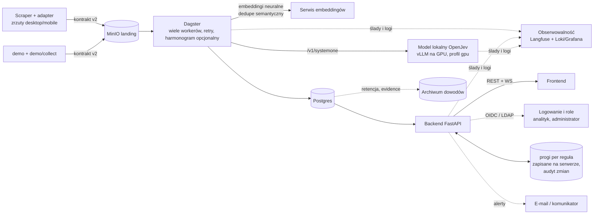

# InvestWatch: architektura

Zasada: serwisy nie wołają się nawzajem w sprawie danych. Łączy je **kontrakt przez dane**: object storage (MinIO) i PostgreSQL.
Jedyne wywołanie HTTP do zewnątrz to model decyzyjny, zamknięty w jednym pliku (`orchestrator/pipeline/llm.py`).

Czytelne diagramy (stan obecny i docelowa architektura) w PDF: [architecture-diagrams.pdf](architecture-diagrams.pdf); źródło: `docs/diagrams/build.py`.

## Diagram: stan obecny

```mermaid
flowchart LR
    subgraph SRC [Źródła danych]
        DEMO[demo/seed<br/>rekordy demo + obrazy]
        SCR[scraper + worker<br/>profil scraper, domyślnie wyłączony<br/>adapter landing.py]
    end

    COL[demo/collect<br/>Playwright, dev] -. "demo/collected" .-> DEMO
    DEMO -- "raw/platform/id/hash.json + obrazy<br/>kontrakt v2" --> RAW[(MinIO<br/>bucket investwatch)]
    SCR -- "po każdym jobie: kontrakt v2<br/>bez duplikatów" --> RAW
    SCR -- "obrazy, miniatury" --> MEDIA[(MinIO<br/>bucket investwatch-media)]
    SCR -- "posts, media, firms" --> DBS[(Postgres<br/>tabele scrapera, Alembic)]

    subgraph ORCH [Orkiestrator: Dagster, assety, start ręczny]
        direction TB
        RD[intake_items<br/>walidacja kontraktu v2] --> DOC[documents<br/>obserwacje, wersje, obrazy]
        DOC --> AB[analysis_batch<br/>IngestConfig: batch, okno wstecz]
        AB --> TR[transcribed_batch<br/>opcjonalny, domyślnie pominięty]
        TR --> PRE[preprocessed_batch<br/>tokeny, wektor cech, duplikaty]
        PRE --> SPL[module_splits<br/>po kolumnie module]
        SPL --> M1[ad_scores M1]
        SPL --> M2[rule_scores M2<br/>18 reguł]
        SPL --> M3[advisory_scores M3]
    end

    RAW -- "lista i odczyt" --> RD
    DOC -- "ledger" --> DB[(Postgres<br/>observations, documents,<br/>document_images, ingestions,<br/>results, annotations, model_calls)]
    M1 & M2 & M3 -. "HTTP /v1/systemone<br/>pytania tak/nie → P 0-1" .-> LLM[Model decyzyjny<br/>OpenJev: Codiv lub lokalnie]
    M1 & M2 & M3 -- "results (surowy score)<br/>+ NOTIFY high_risk<br/>+ model_calls" --> DB

    subgraph APP [Aplikacja]
        BE[Backend FastAPI<br/>REST + WebSocket]
        FE[Frontend React]
    end

    FE -- "POST /api/refresh" --> BE
    BE -. "GraphQL: launchRun process_batch" .-> ORCH
    DB -- "SELECT, próg przy odczycie" --> BE
    DB -. "LISTEN high_risk" .-> BE
    RAW -- "obraz po id rekordu" --> BE
    BE -- "REST: lista, status, oceny, raport" --> FE
    BE == "WebSocket: alerty" ==> FE
    FE -- "PATCH status, POST ocena" --> BE
    BE -- "UPDATE / INSERT" --> DB
```

## Serwisy i profile Compose

| Serwis | Rola | Profil |
|---|---|---|
| `db` | PostgreSQL: baza `investwatch` (`db/init.sql`) i `dagster` (metadane Dagstera) | domyślny |
| `minio` | storage S3: `investwatch` (wejście pipeline'u), `investwatch-media` (scraper) | domyślny |
| `dagster-daemon`, `dagster-webserver` | orkiestrator, UI na :3001 | domyślny |
| `seed` | jednorazowo ładuje `demo/`, `demo/collected` (jeśli jest) i próbki scrapera `data/scraped/` do bucketa `investwatch` w kontrakcie v2 (ponowny start nic nie dubluje) | domyślny |
| `backend`, `frontend` | API i dashboard | domyślny |
| `scraper`, `scraper-worker` | jeden obraz, dwie role: `scraper` to API (:8001) przyjmujące zlecenia i podgląd danych, `scraper-worker` wykonuje joby z kolejki i ma w sobie cron (`SCRAPE_CRON`); po każdym jobie posty trafiają do bucketa `investwatch` w kontrakcie v2 | `scraper` (wyłączony) |
| `redis` | kolejka jobów scrapera (RQ), lock crona przy kilku workerach, rotacja zapytań między runami | `scraper` |
| `searxng` | lokalna metawyszukiwarka: scraper szuka przez nią stron WWW, kanałów Telegram i domen firm, bez płatnych API wyszukiwarek | `scraper` |
| `migrations` | jednorazowo zakłada schemat bazy scrapera (Alembic) i kończy pracę | `scraper` |

`docker compose up --build` stawia cały projekt; scraper włącza `COMPOSE_PROFILES=scraper` w `.env`.
Schemat naszych tabel tworzy `db/init.sql` (pusta baza), schemat scrapera Alembic (`migrations`); nazwy tabel się nie nakładają,
a `include_object` w `migrations/alembic/env.py` chroni nasze tabele przed `--autogenerate`.

## Przepływ danych

1. Materiał trafia jako niezmienny obiekt `raw/{platform}/{external_id}/{hash12}.json` (kontrakt v2, `docs/data-contract.md`): z `demo/`, `demo/collect`, z próbek scrapera (`data/scraped/`) i ze scrapera na żywo przez adapter (`docs/scraper-integration.md`).
2. Operator klika **Odśwież dane** w aplikacji (backend woła GraphQL Dagstera) albo **Materialize all** w Dagsterze. Nic nie startuje samo.
3. `intake_items` bierze obiekty spoza ledgera i waliduje je kontraktem (niepoprawne do kwarantanny). `documents` czyści tekst, liczy hash wersji (tekst + sumy obrazów), zapisuje obserwację (para podmiot-firma), dokument, obrazy i wpis w ledgerze `ingestions`.
4. `analysis_batch` (konfiguracja: `batch_size`, `reprocess_lookback_days`, `modules`) wybiera dokumenty do modelu: nowe i zmienione zawsze, a ocenione innym modelem tylko z okna wstecz.
5. `transcribed_batch`: opcjonalna lokalna transkrypcja audio (Whisper), dziś pomijana, bo nie ma źródeł audio.
6. `preprocessed_batch` (UKNF: preprocessing tekstu przed analizą): tokeny, wektor cech (feature hashing) i wykrywanie duplikatów tekstu w obrębie modułu; duplikat dostaje wynik oryginału.
7. `module_splits` dzieli batch po module; każdy asset modułu woła model (M2 także z parą desktop/mobile dla reguły 8) i zapisuje `results` (surowy score 0-1, per wersja treści) oraz `model_calls`.
8. Backend czyta wynik bieżącej wersji treści i serwuje REST oraz WebSocket; progi (globalny i per reguła) stosuje frontend przy odczycie.

## Gdzie wpięty jest WebSocket (alerty)

Baza jest źródłem prawdy, powiadomienie jest tylko sygnałem:
1. zapis wyniku z `score ≥ ALERT_THRESHOLD` wykonuje w tej samej transakcji `NOTIFY high_risk, '<result_id>'`;
2. backend ma stałe `LISTEN high_risk`, pobiera rekord i rozsyła go do klientów `/ws/alerts`;
3. frontend pokazuje toast i wpis w centrum powiadomień, a po rozłączeniu sam się łączy ponownie.

Orkiestrator nie zna backendu ani frontendu. Przy kilku replikach backendu wystarczy ten sam `LISTEN` w każdej.

## Progi (trzy różne rzeczy)

| Próg | Gdzie | Po co |
|---|---|---|
| `threshold` globalny i per reguła | frontend, przy odczycie (localStorage) | kalibracja FP/FN, nic nie przelicza wstecz; domyślnie 0.5, reguły M2 mogą mieć własny próg, sugestia z ocen analityków (maks. F1) |
| `ALERT_THRESHOLD` | orkiestrator | kiedy wysłać `NOTIFY` / alert |
| `RETAIN_MIN_SCORE` | orkiestrator | co trwale archiwizować; **niewdrożony** (retencja: planowane) |

## Decyzje

1. **Dagster z assetami**, start ręczny (UI Dagstera albo przycisk w aplikacji), bez sensorów i harmonogramów; monitoring w UI Dagstera. Backend zna Dagstera tylko przez GraphQL (`DAGSTER_GRAPHQL_URL`), jeden run naraz.
   Wybór dokumentów do modelu jest parametrem runu (`IngestConfig`), nie logiką rozsianą po kodzie.
2. **MinIO jako jedyny storage** (wspólny ze scraperem), osobne buckety; dostęp do obrazów dla UI wyłącznie przez backend po id rekordu.
3. **Model decyzyjny przez `/v1/systemone`** (pytania tak/nie dają prawdopodobieństwa 0-1, bez generowania tekstu), teraz hostowany, docelowo lokalny na GPU bez zmian w kodzie.
4. **Scraper opcjonalny i rozłączny**: własna baza tabel, własny bucket, profil Compose; pipeline działa bez niego na danych demo.
5. **Surowy score w bazie, próg przy odczycie**: zmiana progu w UI nie wymaga przeliczania.
6. **Kontrakt v2 jako granica źródeł**: niezmienne obiekty landing + ledger ingestii; scraper, demo i zbieranie ręczne zamieniają się za adapterem, bez zmian w pipeline'ie.

Dalszy rozwój: sekcja "Architektura docelowa" niżej. Otwarte: przekazanie układu bloków ze scrapera (`raw.layout`) dla reguł M2, retencja danych, zapis progów per reguła na serwerze, pomiary obrazowe reguł wizualnych (`TODO.md`).

## Architektura docelowa (kolejne iteracje)

Zasada ta sama: serwisy łączy kontrakt przez dane, a nowe elementy są opcjonalne (profile Compose), żeby `docker compose up` nadal stawiał minimum.

| Iteracja | Zakres | Po co |
|---|---|---|
| 1 | Model lokalny na GPU (profil Compose `gpu`, vLLM z OpenJev), bez zmian w kodzie poza `TYPESAFE_BASE_URL` | wymóg on-premise, koniec zależności od Codiv |
| 2 | Scraper: przekazanie `raw.layout` i bloków z ryzykiem (`focus: risk`) dla reguł M2, domeny firm spoza listy marek | pomiary reguł 4-8 i 13 bez zgadywania modelu |
| 3 | Progi per reguła zapisane na serwerze z audytem zmian; sugestie z ocen wielu analityków | wspólna kalibracja zespołu zamiast ustawień w przeglądarce |
| 4 | Logowanie i role (OIDC lub LDAP), podpisane oceny | dziś brak uwierzytelniania (odstępstwo NFR-03) |
| 5 | Obserwowalność: Langfuse na wywołania modelu, Loki/Grafana na logi, metryki Dagstera | jakość i koszt modelu widoczne bez zaglądania do bazy |
| 6 | Embeddingi neuralne (osobny serwis) i dedupe semantyczny; pomiary obrazowe reguł 4, 5, 6 (OCR, kontrast) | lepsze duplikaty i mniej zależności od oceny modelu |
| 7 | Retencja `raw/`, trwałe `evidence/`, powiadomienia poza UI | wymagania danych (pytanie 14) |
| 8 | Skalowanie: kilka workerów Dagstera, repliki backendu (`LISTEN` w każdej), MinIO rozproszone | ruch produkcyjny UKNF |
